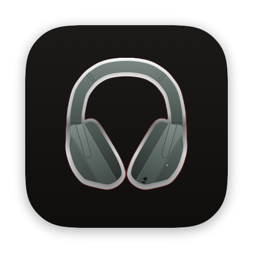
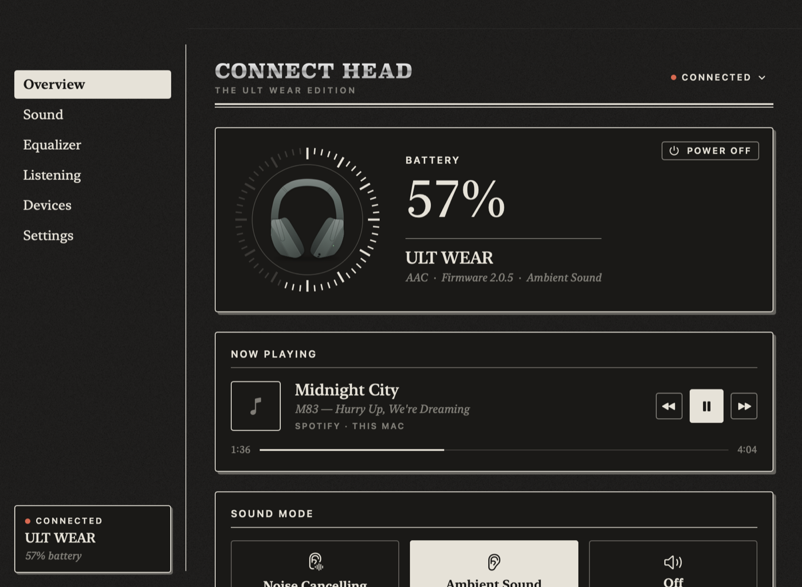
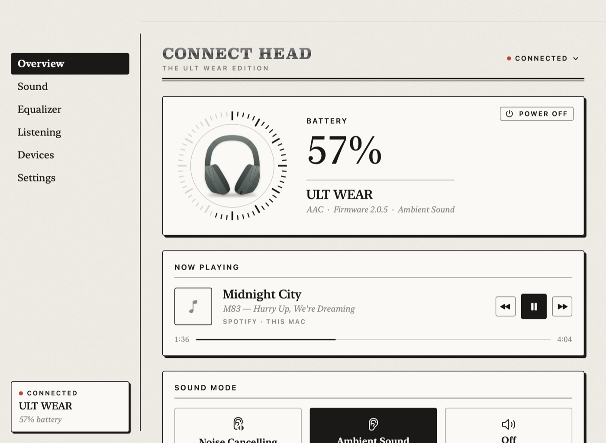
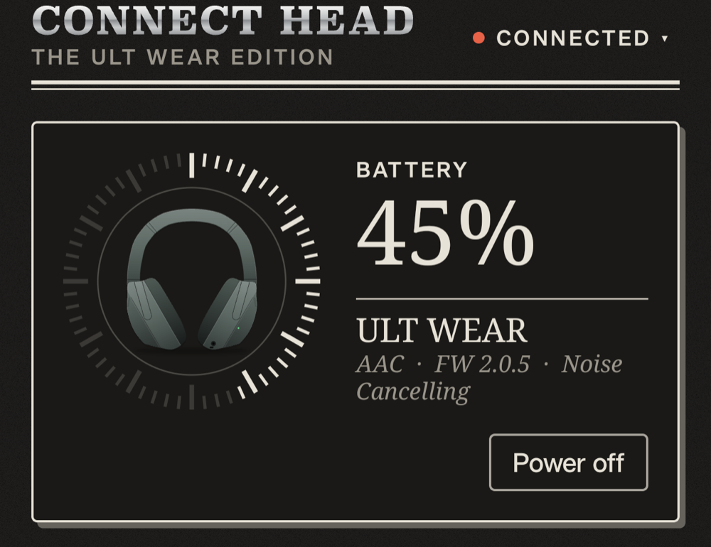
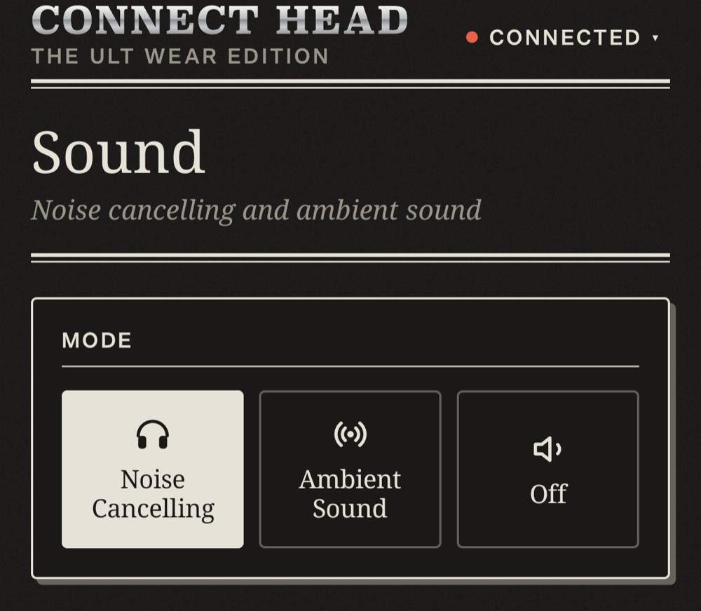
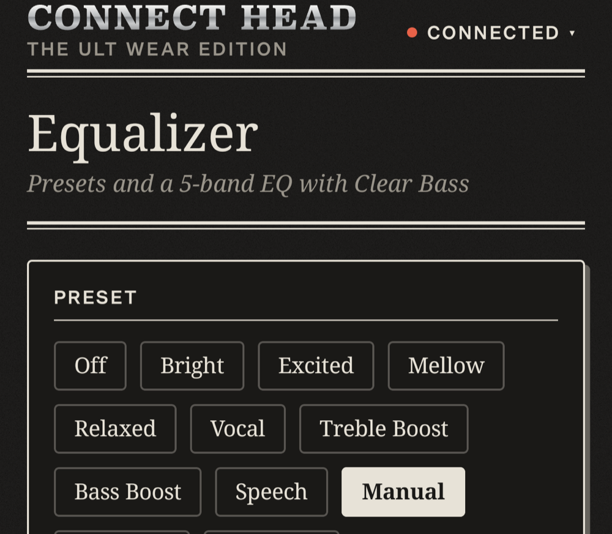
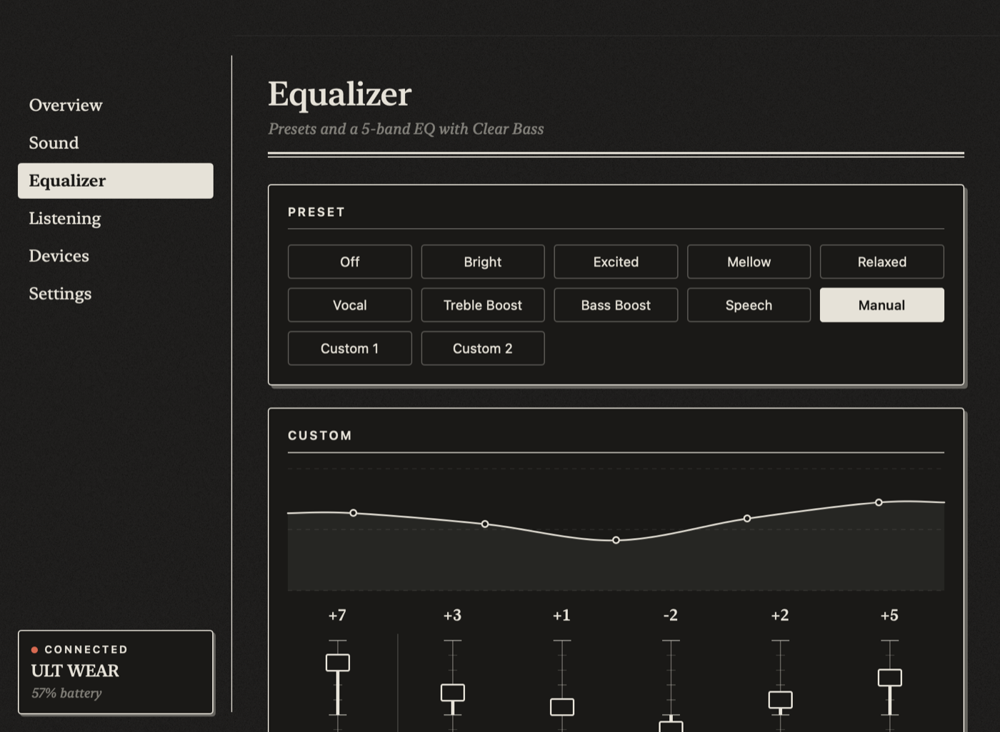
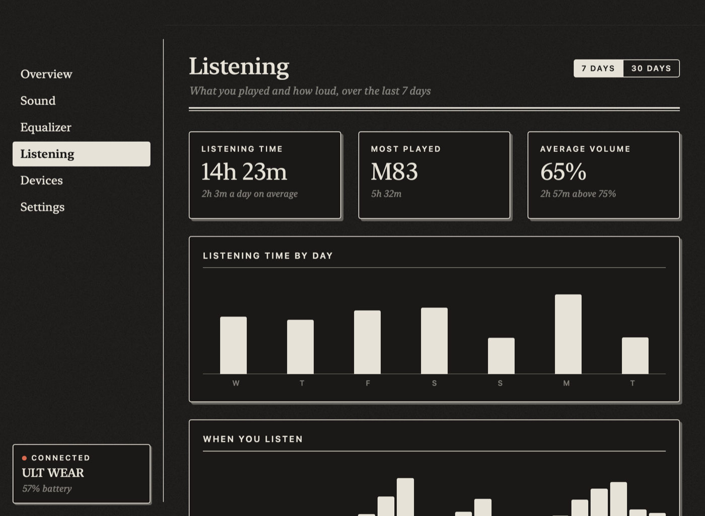

<p align="center">
  
</p>

<h1 align="center">Connect Head</h1>

<p align="center">
  An unofficial companion app for the <b>Sony ULT WEAR</b> (WH-ULT900N) headphones, for <b>macOS</b> and <b>Android</b>.<br>
  Built to replace Sony's app with something faster, calmer and designed like a printed page.
</p>

<p align="center">
  
  
</p>

<p align="center">
  
  
  
</p>
<p align="center"><sub>Mac (top) and Android (bottom)</sub></p>

## What it does

- **Battery at a glance.** A watch-style tick dial around a drawing of the headphones, traced from Sony's product photo.
- **Sound modes.** Noise cancelling, ambient sound (with level and focus on voice) or off, plus what the NC/AMB button cycles through.
- **Equalizer.** Every preset, Clear Bass and the five bands. Drag the curve on the home page, or use the faders.
- **Now Playing.** Apple Music, Spotify and YouTube in Safari or Chromium browsers on the Mac, and any media app on Android, with artwork and controls.
- **Listening analytics.** Listening time by day and hour, top artists and tracks, which app, and how loud you listen. It's built from your Now Playing history and volume, and stays on your device (kept 120 days).
- **Devices.** See the phones and computers paired with the headphones, connect or disconnect them, and move the audio to another one.
- **Settings.** DSEE, LDAC preference, multipoint, voice guidance, voice assistant, auto power off, pause when taken off and more. Only settings the headphones report are shown.
- **Mac extras.** A menu-bar battery, a notification at 20% and 10%, launch at login, and <kbd>⌃⌥N</kbd> to cycle sound modes from anywhere.

<p align="center">
  
  
</p>

## Mac and phone, at the same time

The headphones accept only one controlling device at a time, so two apps would normally keep knocking each other off. Connect Head avoids that:

1. The Mac app shares the headphones' state on your local network (Bonjour `_connecthead._tcp`).
2. When the Android app finds it, it reads the state from the Mac and sends its commands through it, instead of taking the connection.
3. When the Mac isn't around, the phone connects directly, and hands the connection back when you leave the app.

Requests must carry the headphones' Bluetooth address, which only devices paired with them know, so others on the network can't read or control anything. The same link lets the phone show what's playing on the Mac.

## Design

It's styled like a printed newspaper: warm paper and ink in light mode, black paper in dark mode, serif type, hairline rules and hard offset shadows. There's no glow and no gradient-heavy dashboard look. The wordmark nods to Sony's silver logo, set in wide Clarendon capitals.

## Build it yourself

You need the headphones paired with your device first.

**macOS** (14 or later):

```bash
cd mac
./build.sh --install   # builds, copies to /Applications and launches it
```

Allow Bluetooth access on first launch. The app is ad-hoc signed, so macOS asks again after each rebuild. For YouTube progress and controls in a browser, turn on *Allow JavaScript from Apple Events* in that browser.

**Android** (10 or later; needs the Android SDK and JDK 21):

```bash
cd android
./install.sh                         # builds, installs on a USB-debugging phone, opens it
./gradlew :app:testDebugUnitTest     # protocol tests
```

Allow *Nearby devices* to reach the headphones, and *Notification access* for Now Playing. Connect Head reads only media sessions, not your notifications.

More detail is in [`mac/README.md`](mac/README.md) and [`android/README.md`](android/README.md).

## How it works

The headphones expose a Sony RFCOMM service. Both apps speak the framed protocol that the [Gadgetbridge](https://codeberg.org/Freeyourgadget/Gadgetbridge) project reverse-engineered: start and end bytes, escaping, a checksum, and one-at-a-time acknowledged requests. The ULT WEAR has quirks of its own, such as an extra byte in equalizer messages, which the apps detect.

| | macOS | Android |
| --- | --- | --- |
| Language | Swift, SwiftUI | Kotlin, Jetpack Compose |
| Bluetooth | IOBluetooth RFCOMM | `BluetoothSocket` RFCOMM |
| Now Playing | AppleScript (Music, Spotify, browsers) | `MediaSessionManager` |
| Sharing | `NWListener` + Bonjour | `NsdManager` + HTTP |

## Credits

- [Gadgetbridge](https://codeberg.org/Freeyourgadget/Gadgetbridge), for reverse-engineering the Sony headphone protocol. This project wouldn't exist without it.
- [mos9527/SonyHeadphonesClient](https://github.com/mos9527/sonyheadphonesclient), for documenting multipoint device management.

## Licence

[AGPL-3.0](LICENSE), the same licence as Gadgetbridge, whose protocol work this builds on.

Connect Head is an independent project. It isn't affiliated with or endorsed by Sony. "Sony" and "ULT WEAR" are trademarks of Sony Group Corporation.
